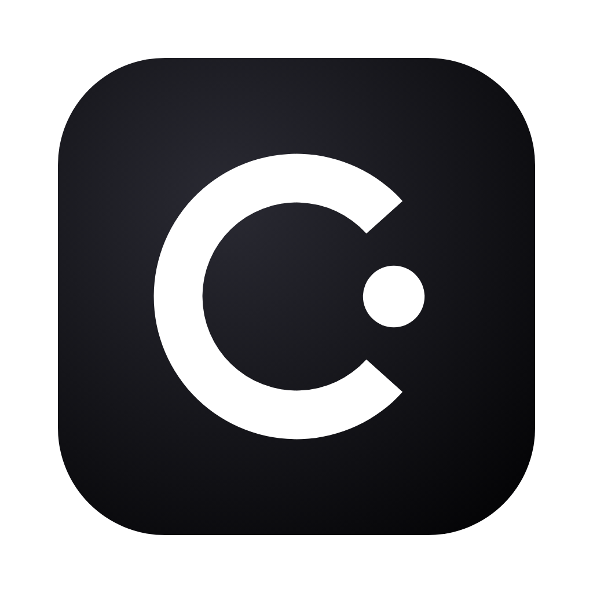

# CosmoGrav

_For Mac and Windows. Formerly Cosmos Media Downloader._



Download videos from YouTube, TikTok, Instagram, Facebook, Vimeo and more in HD, as **H.264 MP4 files that import straight into Premiere Pro**. On Mac it also downloads any other file (zip, pdf, images, audio, project files) and public Google Drive, Dropbox and OneDrive links, faster and resumable. Made by [Creation of Cosmos](https://www.creationofcosmos.com).

**Please only download content you have the rights to use.**

## Install on Windows (once, about 2 minutes)

1. Click **Start**, type `PowerShell`, and press **Enter**. A blue window opens.
2. Copy this line. Click inside the blue window, **right-click** to paste it, and press **Enter**:

```powershell
irm https://raw.githubusercontent.com/raetori/ultra-hd-youtube-downloader/main/install.ps1 | iex
```

3. Wait until it says **All set!**. CosmoGrav opens by itself. You can close the blue window.

CosmoGrav is now in your **Start menu** and on your **desktop**. No admin password and no "Windows protected your PC" warning. Needs Windows 10 or 11 (64-bit).

## Install on Mac (once, about 2 minutes)

1. Open **Terminal**: press **Cmd + Space**, type `Terminal`, press **Return**.
2. Copy this line, paste it into Terminal (**Cmd + V**), and press **Return**:

```bash
/bin/bash -c "$(curl -fsSL https://raw.githubusercontent.com/raetori/ultra-hd-youtube-downloader/main/install.sh)"
```

3. Wait until it says **All set!**. CosmoGrav opens by itself. You can close Terminal.

CosmoGrav is now in your **Applications** folder. No Homebrew, no admin password and no security warnings. Needs macOS 13 (Ventura) or newer.

## Updates

When a new version is out, CosmoGrav shows an **Update now** button at the top. Click it and the app updates and reopens. Nothing else to do.

## Use it

1. Copy one or more links, then click **Paste links** (or drag links into the window). Playlists are added as separate videos.
2. For each video you can:
   - **Rename** the file (click the name)
   - **Trim** to a start and end time, like `1:30`
   - Pick the **quality**: Best HD (up to 4K), HD 1080p (faster), ProRes 422 HQ (.mov, for heavy editing and grading), Audio MP3, Audio WAV, or **Captions only (SRT)** (Mac), which saves just the subtitles and no video
3. Click **Download**. Two videos download at a time by default (choose 1, 2 or 3 with **At once**). Cancel any video with its ✕ button.
4. Pick where files go with **Save to**. Click the folder button on a finished video to see it in File Explorer (Windows) or Finder (Mac).
5. Copied a link in your browser? Switch to the app and it offers to add it.
6. Got a long list (dozens or hundreds of links)? Click **Import list** (⌘O) on Mac, then open a `.txt` or `.csv` file or paste the list. You can also drop the file on the window, and a paste of more than 20 links opens the same screen. CosmoGrav removes repeats, lists any lines it skipped, keeps videos, Shorts and playlists apart, and divides the list into batches of 10, 25, 50 or 100. Pick **Download as** to set the quality for the whole list, including Captions only (SRT). Each batch can go into its own folder, and batches can download one after another on their own. **Save batches as files** writes each batch to its own `.txt`. The list is read only on your computer and only web links (http/https) are accepted.
7. Coming from **JDownloader**? CosmoGrav reads `.crawljob` files (Mac), in both the plain `text=` form and the JSON form. Double-click one, drop it on the window, or use **File → Open .crawljob** (⇧⌘O). You see each package with its links and folder, tick the ones you want, and add them. CosmoGrav uses `text` (the links), `packageName` (a folder of that name in your save folder), `downloadFolder` (including `<jd:packagename>`; it must be inside your home folder or on an external drive), `filename`, `enabled` and `autoStart`. Other fields, such as priority, chunks and passwords, are ignored and never stored.
   - **Folder Watch**: turn it on in **Settings** and pick a folder (by default `Downloads/CosmoGrav Folder Watch`). Any `.crawljob` file saved there is added on its own within a few seconds, and then moved into an `added` folder inside it, just like JDownloader's Folder Watch.
8. **Files and cloud links** (Mac): paste a link to any file, like a `.zip`, `.pdf`, `.wav`, `.psd` or a project file, or a public share link from **Google Drive**, **Dropbox** or **OneDrive**. The file is kept exactly as it is (only video gets converted). Big files download over up to 8 connections at once, a dropped connection retries on its own, and the ✕ button pauses: click Download again (even after quitting) and it carries on where it stopped. Share links must be set to "Anyone with the link". **File host pages** (like mediafile.cc, where the link opens a page with a download button): the row shows **Open download page**. It opens the page in CosmoGrav's own browser; use the site's free download button, wait out its timer and answer any robot check yourself, and CosmoGrav takes the file into the queue at the site's own speed. Pop-up ads are blocked and the browser keeps no cookies afterwards. Google Drive folders and MEGA links can't be downloaded from a link (MEGA encrypts its files), and nothing that needs a login, a captcha or a wait in the browser is bypassed.
9. In **Settings** you can also save captions (.srt) next to each video and get a notification when downloads finish.

Every video comes out as H.264 + AAC MP4. If the site's file is already H.264 it is kept as is (instant). Otherwise it is converted with your computer's built-in video encoder (Apple's on Mac; NVIDIA, Intel or AMD graphics on Windows, or the processor when there is none).

## Chrome extension (Mac, CosmoGrav 1.7 and newer)

Download straight from the browser. Works in Google Chrome, Brave, Microsoft Edge, Arc, Vivaldi and Chromium.

**Set it up once (1 minute):** in CosmoGrav choose **File → Set Up Chrome Extension…** (or Settings → Browser extension). Chrome's Extensions page and a Finder window open. Turn on **Developer mode** (top right of the Extensions page), then drag the **Chrome Extension** folder from Finder onto the page. That's it.

**What it does**

- **Right-click** any link, video, audio, image or page → **Download with CosmoGrav**, or **Download with CosmoGrav as** → Best HD MP4, 1080p MP4, MP3, WAV, SRT captions or ProRes. Select text with several links and choose **Download every link in the selection**.
- **Hover button** on videos and large images on any site (turn it on in the extension's settings; Chrome asks once). Images are sent at their full-size original where the site has one (X, Pinterest, Reddit, Wikipedia, WordPress, Unsplash).
- **YouTube**: a CosmoGrav button under every video with quality choices, **clip marks** (mark start and end while watching, then download just that part), **last 30 seconds up to here**, **save this frame** as a full-resolution PNG, **download the thumbnail** at its largest size, **copy link at this moment**, and **whole playlist**. Thumbnails and Shorts get a hover button too.
- **Grab all media on this page**: lists every video, video page, image, audio and file link on the page so you can tick what you want and send it to the queue or to the Import window.
- **Send all tabs** in the window to the Import window.
- **Shortcuts**: ⌥⇧G downloads the page you're on, ⌥⇧C opens the CosmoGrav menu (change them at `chrome://extensions/shortcuts`).
- The menu shows what's downloading right now, with progress, and buttons to open CosmoGrav or your downloads folder.

**Updates:** the extension comes inside the app. When CosmoGrav updates, it brings the matching extension, and Chrome picks it up on its own within the hour, or right away when you open the CosmoGrav menu.

**Privacy and safety:** the extension talks only to CosmoGrav on your Mac, through Chrome's native messaging (no network port, no server, and only this extension may use it). It keeps no history and sends nothing anywhere. It asks for the "all sites" permission only if you turn on the hover button for other sites, and for your tabs only when you click Send all tabs. Links opened as `cosmograv://add?url=…` from a web page are added but never started on their own.

### Instagram, Facebook and logins

Public posts usually work without logging in. If a site refuses, the video shows **Use my login**: pick your browser once in **Settings** and the app borrows that browser's login. It is never used unless you click it. On Windows, **Firefox** works best: Chrome and Edge lock their logins away from other apps.

## Privacy

Everything runs on your own computer. No accounts, no tracking, nothing is sent to Creation of Cosmos or GitHub. History is stored only on your computer and can be cleared in Settings.

## Troubleshooting

- **A download fails**: check the link and click the retry button. In Settings, **Update now** refreshes the download engine (it also updates itself daily).
- **Still failing**: run the install line again. It repairs everything.
- **Windows: "irm is not recognized"**: you opened the old Command Prompt (black window). Open **PowerShell** instead (step 1).

## Uninstall

- **Windows**: Settings → Apps → Installed apps → **CosmoGrav** → Uninstall. Your downloaded videos are kept.
- **Mac**: drag **CosmoGrav** from Applications to the Trash, then delete `~/Library/Application Support/TeamYTDownloader` (in Finder: Cmd + Shift + G, paste the path).

## For maintainers

- `app/` is the Mac app (SwiftUI). Pushing changes to `app/` on `main` makes GitHub build it and publish a release `v…` (`.github/workflows/build-app.yml`).
- `windows/` is the Windows app (WPF, .NET Framework 4.8, which every Windows 10 and 11 PC has). Pushing changes to `windows/` or `install.ps1` builds it on Windows, installs it with `install.ps1`, runs real downloads, photographs every screen, and on `main` publishes a release `win-v…` (`.github/workflows/build-windows.yml`). Windows releases are never marked "latest", so they don't affect the Mac installer.
- To ship an update to everyone, raise the number in `app/VERSION` (Mac) or `windows/VERSION` (Windows). Apps on a lower version offer **Update now**.
- `install.sh` (Mac) and `install.ps1` (Windows) install the download tools and the latest release.
- Screenshots of every Windows screen from the last build are on the [ci-preview](https://github.com/raetori/ultra-hd-youtube-downloader/releases/tag/ci-preview) pre-release (`windows-*.png`).

---

Built on [yt-dlp](https://github.com/yt-dlp/yt-dlp), [FFmpeg](https://ffmpeg.org) and [Deno](https://deno.com).
