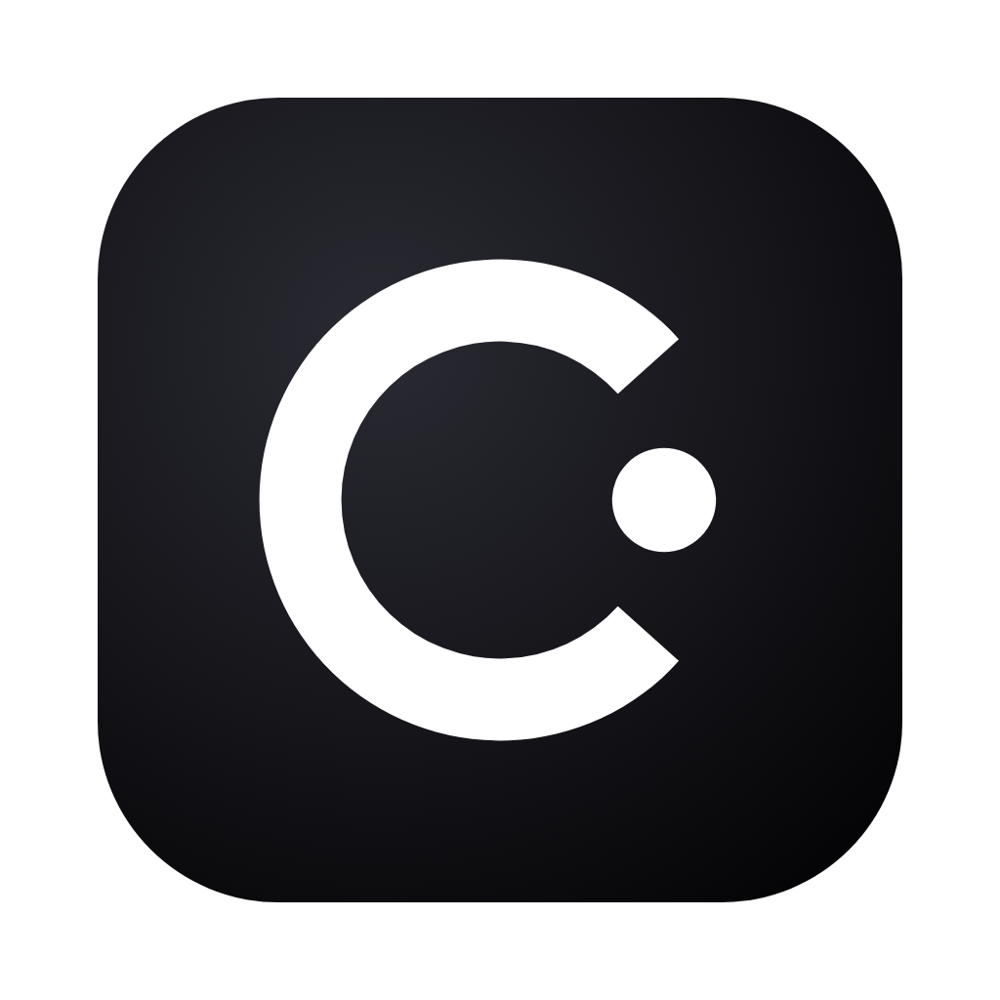

# Cosmos YouTube Downloader (Mac)



Download YouTube videos in HD as **H.264 MP4 files that import straight into Premiere Pro**. No WebM, no conversion step on your side. Made by [Creation of Cosmos](https://www.creationofcosmos.com).

**Please only download videos your team has the rights to use.**

## Install (once, about 2 minutes)

1. Open **Terminal**: press Cmd + Space, type `Terminal`, press Return.
2. Paste this line and press Return:

```bash
/bin/bash -c "$(curl -fsSL https://raw.githubusercontent.com/raetori/ultra-hd-youtube-downloader/main/install.sh)"
```

3. When it says **All set!**, the app opens by itself. Close Terminal.

No Homebrew, no admin password, no security warnings. Run the same line again any time to repair or update.

## Use it

1. Copy a YouTube link in your browser.
2. Open **Cosmos YouTube Downloader** (Launchpad, or Cmd + Space and type its name). The link is filled in for you. Click **Next**.
3. Choose a format and click **Download**:

| Option | What you get |
|---|---|
| HD video for Premiere (best quality) | Highest resolution YouTube has (up to 4K), as an H.264 + AAC MP4. 4K videos take a bit longer because they are converted on your Mac using its built-in video encoder. |
| HD video for Premiere (1080p, faster) | 1080p H.264 MP4. Usually no conversion at all, so it is quick. |
| Audio only | MP3 |

Downloading the same video again replaces the old copy. The app keeps its downloader up to date by itself.

## Troubleshooting

- **"The download didn't work"**: check the link, wait a minute, try again.
- **Still failing**: run the install line again.
- Click **Open Log** in the error box and send the text to whoever maintains this repo.

## Uninstall

Drag **Cosmos YouTube Downloader** from Applications to the Trash, then delete `~/Library/Application Support/TeamYTDownloader` (in Finder: Cmd + Shift + G, paste the path).

---

Made by [Creation of Cosmos](https://www.creationofcosmos.com). Built on [yt-dlp](https://github.com/yt-dlp/yt-dlp), [FFmpeg](https://ffmpeg.org) and [Deno](https://deno.com).

## For maintainers

`install.sh` is generated. Edit the files in `src/` (`ytdl.sh` is the download helper, `app.applescript` is the app, `install-template.sh` is the installer), then run `bash src/build.sh` and commit the updated `install.sh`. Teammates pick up changes by running the install line again.
